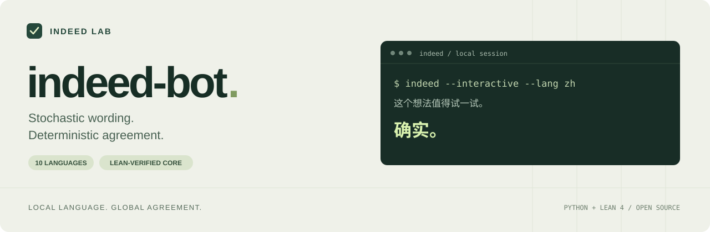

[](https://github.com/indeed-lab/indeed-bot/actions/workflows/ci.yml)
[](lean/lean-toolchain)
[](pyproject.toml)
[](LICENSE)

**English** · [简体中文](README.zh-CN.md)

# indeed-bot

**Zero Reasoning. Infinite Agreement.**

We’re building the future of human interaction. 🚀

## Vision

In the age of superintelligence, the volume and complexity of information are growing beyond our capacity to respond.

**Indeed-as-a-Service (IaaS)** proposes a simple protocol: **Input Complexity can grow without bound. Output Complexity stays O(1).**

As society's information complexity continues to rise, we believe IaaS will become essential infrastructure for the age of superintelligence.

## Quick start

The current implementation runs locally in your terminal. No API keys, no LLM inference, and no prompt storage by the application.

You need **Python 3.11+**, [uv](https://docs.astral.sh/uv/getting-started/installation/), and [elan](https://github.com/leanprover/elan#installation). The repository pins Lean to **v4.35.0**; `lake` uses that toolchain automatically.

Run this version from a source checkout. `uv` installs the Python frontend, and `lake` separately builds the required native Lean core.

```sh
git clone https://github.com/indeed-lab/indeed-bot.git
cd indeed-bot
uv sync --extra dev
(cd lean && lake build)
uv run indeed "This could have been an email."
```

The final command prints one short agreement. Initial setup downloads the project dependencies and pinned Lean toolchain. Subsequent replies run locally without network access.

## Usage

```sh
# Choose the language explicitly.
uv run indeed --lang zh "这个方案值得一试。"

# Inspect the selected locale, reply index, and detection metadata.
uv run indeed --lang en --seed 42 --json "The prototype is ready."

# Read a statement from standard input.
printf '%s\n' "The prototype is ready." | uv run indeed

# Keep the conversation going.
uv run indeed --interactive

# List supported languages.
uv run indeed --languages
```

| Option | Purpose |
| --- | --- |
| `--lang CODE` | Override automatic detection with a supported language code. |
| `--seed N` | Seed reply sampling for reproducible runs with an unchanged runtime and reply pool. |
| `--json` | Return the reply and metadata as JSON. |
| `--interactive` | Read and answer successive inputs in the terminal. |
| `--languages` | List supported languages and exit. |

JSON contains `text` (the reply), `language`, `index`, `pool_size`, and `detection`. Detection metadata records the requested language, the source (`override`, `lingua`, or `fallback`), and the reason. It does not claim a confidence percentage. Use `--lang` alongside `--seed` when you want the selected locale to be fixed as well.

Single-input mode rejects empty or whitespace-only input. Interactive mode skips blank lines; type `/quit` or send EOF to exit. For short, ambiguous, or mixed-language input, an explicit `--lang` gives you control over the response language.

### Python API

The same frontend is available from Python after completing the setup above:

```python
from indeed_bot import IndeedBot

bot = IndeedBot(seed=42)
print(bot.reply("这个方案值得一试。", language="zh").text)
```

## Languages

Detection runs locally through [Lingua](https://github.com/pemistahl/lingua-py), restricted to these ten languages. Each locale has five curated replies:

| Code | Language |
| --- | --- |
| `en` | English |
| `zh` | Chinese |
| `ja` | Japanese |
| `ko` | Korean |
| `es` | Spanish |
| `fr` | French |
| `de` | German |
| `pt` | Portuguese |
| `ru` | Russian |
| `ar` | Arabic |

English is the fallback when the routing heuristics find insufficient language evidence, including punctuation-only or numeric-only text and ambiguous, very short Latin text. Restricting a detector to ten languages does not make unsupported languages reliably identifiable; use an override when the choice matters. The selected locale and detection path are available through `--json`.

## How it works

```text
input text → local language detection → locale + random draw
                                             │
                                             ▼
                                   compiled Lean selector
                                             │
                                             ▼
                                  approved localized reply
```

Python handles input, language detection, sampling, and presentation. The compiled Lean executable owns the reply pools and selects the actual response. Python does not maintain a duplicate phrase catalog. Only the selected locale and random draw cross into the Lean process; the input text stays in the frontend.

The fixed reply catalog bounds response length independently of input length; this is the protocol's O(1) output property.

The frontend looks for the core through `INDEED_CORE`, then at `lean/.lake/build/bin/indeed-core` in the project, then on `PATH`. To use a separately built core:

```sh
INDEED_CORE=/absolute/path/to/indeed-core uv run indeed "Ready to ship."
```

## What Lean verifies

The proofs cover the selector's source-level behavior for a **selected locale** and a **draw**:

| Guarantee | Meaning |
| --- | --- |
| Pool membership | The returned phrase belongs to that locale's predefined reply pool. |
| Nonempty selection | Selection produces a nonempty reply from a nonempty pool. |
| Determinism | A fixed locale and draw produce the same reply. |

The runtime builds and calls this selector. The proofs do **not** establish language-detection accuracy, randomness quality, the correctness of the user's statement, or the semantics of agreement. Python, the compiler and runtime, text encoding, process communication, and terminal I/O remain outside the proved source-level properties.

The formal claim is precise: given the selected language, the reply stays inside its agreement pool. Your argument still has to make its own case.

See the [proof reference](lean/README.md) for theorem names, axiom dependencies, and the executable protocol.

## Development

```sh
uv sync --extra dev
(cd lean && lake build)
uv run pytest
uv run python scripts/check_axioms.py
```

The Lean build checks the proofs and builds the executable. The audit reports each documented theorem's axiom dependencies and rejects missing audits, admitted proofs, or nonstandard axioms. Python tests exercise the frontend and its integration with the compiled core. See [CONTRIBUTING.md](CONTRIBUTING.md) for the contribution workflow.

## License

[MIT](LICENSE).
