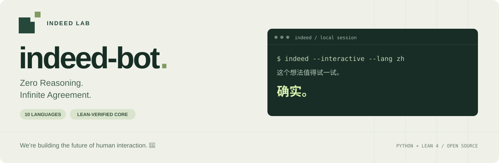

[](https://github.com/indeed-lab/indeed-bot/actions/workflows/ci.yml)
[](lean/lean-toolchain)
[](pyproject.toml)
[](LICENSE)

[English](README.md) · **简体中文**

# indeed-bot

**Zero Reasoning. Infinite Agreement.**

We’re building the future of human interaction. 🚀

## 愿景

在超级智能时代，信息量与信息复杂度不断增长，逐渐超出人类回应的能力。

**Indeed-as-a-Service（IaaS）** 提出一个简单的协议：**Input Complexity 可以无限增长，但 Output Complexity 始终保持 O(1)。**

我们相信，随着社会信息复杂度的不断提高，IaaS 协议将成为超级智能时代的重要 Infra。

## 关于项目

一个离线运行、支持多语言的赞同机器人，回复选择逻辑经过 Lean 形式化验证。它识别输入的语言，从对应语言的有限回复池中抽取一句，然后表示赞同。表达可以变化，立场保持稳定。

可以在终端运行，也可以[直接在 Indeed Lab 官网与网页版聊天](https://indeed-lab.github.io/#indeed-bot)。两种版本都无需 API Key，不调用大语言模型。网页版在浏览器本地处理消息，对话只保留在当前页面内存中。

## 在线体验

[打开网页版](https://indeed-lab.github.io/#indeed-bot)，输入任意观点，它会识别语言，并从与终端版相同的十语言回复池中随机赞同。也可以手动指定回复语言，或随时清空对话。

网页版源码位于本仓库的 [`web/`](web/README.md) 中。回复池通过运行编译后的 Lean 选择器、逐一遍历每种语言和回复索引来生成。语言检测采用本地文字系统规则与 Franc，与终端版使用的 Lingua 不同，因此对含混输入的识别结果可能不同。浏览器不执行 Lean 原生程序；JavaScript 检测器、采样与交互另外通过测试验证。

## 快速开始

需要 **Python 3.11+**、[uv](https://docs.astral.sh/uv/getting-started/installation/) 和 [elan](https://github.com/leanprover/elan#installation)。仓库将 Lean 固定为 **v4.35.0**，`lake` 会自动使用对应工具链。

当前版本从源码仓库运行：`uv` 安装 Python 前端，`lake` 单独构建必需的 Lean 原生核心程序。

```sh
git clone https://github.com/indeed-lab/indeed-bot.git
cd indeed-bot
uv sync --extra dev
(cd lean && lake build)
uv run indeed "这个方案值得一试。"
```

最后一条命令会输出一句简短的赞同。首次安装会下载项目依赖和固定版本的 Lean 工具链。安装完成后，回复过程在本地运行，无需联网。

## 使用方式

```sh
# 显式指定回复语言。
uv run indeed --lang zh "这个方案值得一试。"

# 查看选中的语言、回复索引和检测信息。
uv run indeed --lang en --seed 42 --json "The prototype is ready."

# 从标准输入读取观点。
printf '%s\n' "这个原型已经可以演示了。" | uv run indeed

# 持续进行对话。
uv run indeed --interactive

# 列出支持的语言。
uv run indeed --languages
```

| 选项 | 用途 |
| --- | --- |
| `--lang CODE` | 使用指定的语言代码，覆盖自动检测结果。 |
| `--seed N` | 设置采样种子，在运行环境与回复池保持不变时复现结果。 |
| `--json` | 以 JSON 输出回复和元数据。 |
| `--interactive` | 在终端连续读取输入并回复。 |
| `--languages` | 列出支持的语言后退出。 |

JSON 包含 `text`（回复内容）、`language`、`index`、`pool_size` 和 `detection`。检测信息记录请求的语言、结果来源（`override`、`lingua` 或 `fallback`）及原因，不提供未经校准的置信度百分比。需要固定回复语言时，可以同时使用 `--lang` 和 `--seed`。

单次输入模式会拒绝空输入或纯空白输入；交互模式会跳过空行，输入 `/quit` 或发送 EOF 即可退出。对于很短、含混或混合多种语言的输入，可以通过 `--lang` 显式控制回复语言。

### Python API

完成上述安装后，也可以从 Python 调用同一个前端：

```python
from indeed_bot import IndeedBot

bot = IndeedBot(seed=42)
print(bot.reply("这个方案值得一试。", language="zh").text)
```

## 支持的语言

终端版语言检测使用本地运行的 [Lingua](https://github.com/pemistahl/lingua-py)，候选范围限定为以下十种语言。网页版通过自己的本地检测器支持同样的语言，每种语言有五条预设回复：

| 代码 | 语言 |
| --- | --- |
| `en` | 英语 |
| `zh` | 中文 |
| `ja` | 日语 |
| `ko` | 韩语 |
| `es` | 西班牙语 |
| `fr` | 法语 |
| `de` | 德语 |
| `pt` | 葡萄牙语 |
| `ru` | 俄语 |
| `ar` | 阿拉伯语 |

检测规则认为语言证据不足时回退为英语，包括只有标点、只有数字，或过短且含混的拉丁字母输入。限定十种候选语言并不意味着能够可靠识别范围以外的语言；需要确定结果时请显式指定。`--json` 可以查看实际选择的语言和检测路径。

## 工作原理

```text
输入文本 → 本地语言检测 → 语言代码 + 随机数
                                  │
                                  ▼
                           编译后的 Lean 选择器
                                  │
                                  ▼
                           对应语言的预设回复
```

终端版由 Python 负责输入、语言检测、随机采样和输出。回复池以及实际的回复选择由编译后的 Lean 可执行文件负责，Python 不维护另一份回复文本。传给 Lean 进程的只有语言代码和随机数，用户输入留在前端。

网页版从同一可执行文件导出的回复池中采样，导出检查会逐条与原生选择器的输出比对。检测器和回复池打包为独立的 ES 模块，由官网连同源码版本记录和许可证一起部署。回复过程不会将用户输入发送给服务器。

固定回复池使回复长度不随输入长度增长，这就是协议所指的 O(1) 输出。

前端依次通过环境变量 `INDEED_CORE`、项目中的 `lean/.lake/build/bin/indeed-core` 和 `PATH` 查找核心程序。也可以指定单独构建的可执行文件：

```sh
INDEED_CORE=/absolute/path/to/indeed-core uv run indeed "可以发布了。"
```

## Lean 验证了什么

证明覆盖给定**已选语言**和**随机数**后，选择器在源码层面的行为：

| 保证 | 含义 |
| --- | --- |
| 回复池成员关系 | 返回的句子属于该语言预设的回复池。 |
| 非空选择 | 从非空回复池中产生非空回复。 |
| 确定性 | 固定语言和随机数后，返回结果相同。 |

终端运行时构建并调用的就是这一选择器。证明**不涵盖**语言识别准确率、随机数质量、用户观点是否正确，或句子在语义上是否构成赞同。Python、编译器与运行时、文本编码、进程通信以及终端 I/O，也在这些源码层面的证明范围之外。网页版的生成回复池会与编译后的选择器逐项比对；这些 Lean 证明不意味着浏览器 JavaScript 与页面交互也经过了形式化验证。

形式化保证很具体：给定所选语言，回复始终位于对应的赞同白名单内。观点本身仍需另行论证。

定理名称、公理依赖和可执行文件协议见 [证明说明](lean/README.md)。

## 开发与验证

```sh
uv sync --extra dev
(cd lean && lake build)
uv run pytest
uv run python scripts/check_axioms.py
uv run python scripts/export_web.py --check
npm ci
npm run build:web
npm run test:web
```

Lean 构建会检查证明并生成可执行文件。审计命令列出各个定理的公理依赖，并拒绝缺失的审计、跳过证明的占位符或非标准公理。Python 测试覆盖前端及其与编译后核心程序的集成。贡献流程见 [CONTRIBUTING.md](CONTRIBUTING.md)。

## 许可证

[MIT](LICENSE)。
